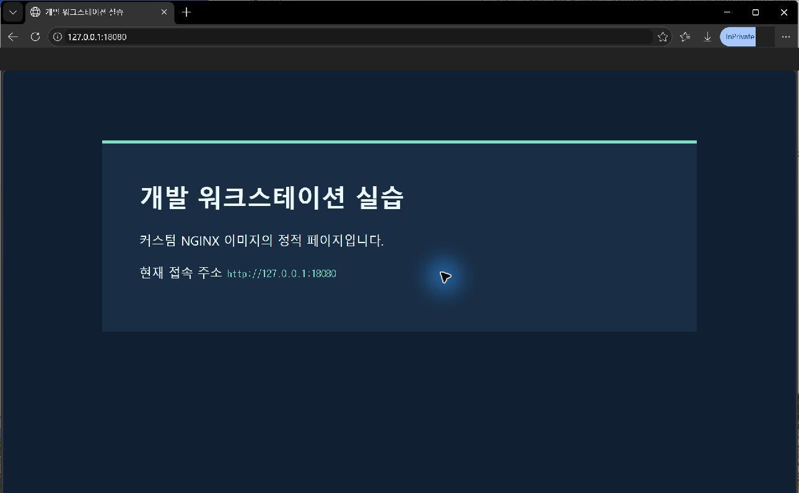

# Docker 실습 로그

2026-11-19 Windows Git Bash에서 실행했다. 개인 경로와 Docker 내부 게이트웨이 주소를 마스킹했다. 실행 종료 코드는 `0`이었다.

```text
$ bash scripts/docker-lab.sh
+ docker --version
Docker version 29.9.3, build 5457199
+ docker info --format 'Server={{.ServerVersion}} OS={{.OSType}} Architecture={{.Architecture}} Storage={{.Driver}}'
Server=29.9.3 OS=linux Architecture=x86_64 Storage=overlayfs
+ docker pull hello-world
Using default tag: latest
latest: Pulling from library/hello-world
Digest: sha256:1e4c05b897a751332ce85c7e9449da2d93514ea2dea6dbb0e2753c9e949b2bfa
Status: Image is up to date for hello-world:latest
docker.io/library/hello-world:latest
+ docker run --rm hello-world

Hello from Docker!
This message shows that your installation appears to be working correctly.

To generate this message, Docker took the following steps:
 1. The Docker client contacted the Docker daemon.
 2. The Docker daemon pulled the "hello-world" image from the Docker Hub.
    (amd64)
 3. The Docker daemon created a new container from that image which runs the
    executable that produces the output you are currently reading.
 4. The Docker daemon streamed that output to the Docker client, which sent it
    to your terminal.

To try something more ambitious, you can run an Ubuntu container with:
 $ docker run -it ubuntu bash

Share images, automate workflows, and more with a free Docker ID:
 https://hub.docker.com/

For more examples and ideas, visit:
 https://docs.docker.com/get-started/

+ docker pull ubuntu:24.04
24.04: Pulling from library/ubuntu
Digest: sha256:73b999393d07f2bf65a40373778a44dc9a6d54ad7718d29247d8ff9413c4d6a8
Status: Image is up to date for ubuntu:24.04
docker.io/library/ubuntu:24.04
+ docker run -d --name e11-1795074388-1300-ubuntu ubuntu:24.04 sleep infinity
9330e8b27c8fa622a700ebf7ad15ad03d7dc01df3b3ac6d987cfc413aceb1eee
+ docker exec e11-1795074388-1300-ubuntu sh -c 'ls -d /etc /tmp; echo ubuntu-exec-exit; exit'
/etc
/tmp
ubuntu-exec-exit
+ docker inspect --format 'After exec exit: {{.State.Status}}' e11-1795074388-1300-ubuntu
After exec exit: running
++ docker inspect --format '{{.State.Status}}' e11-1795074388-1300-ubuntu
+ test running = running
+ docker create -i --name e11-1795074388-1300-attached ubuntu:24.04 sh
654dfc453d56d6eea04123eae57d0d715f913fd38003bc6c5446e0df516694dc
+ printf '%s\n' 'echo ubuntu-main-shell-exit' exit
+ docker start -ai e11-1795074388-1300-attached
ubuntu-main-shell-exit
+ docker inspect --format 'After attached PID 1 exits: {{.State.Status}}' e11-1795074388-1300-attached
After attached PID 1 exits: exited
++ docker inspect --format '{{.State.Status}}' e11-1795074388-1300-attached
+ test exited = exited
+ docker stop e11-1795074388-1300-ubuntu
e11-1795074388-1300-ubuntu
+ docker build -t e11-workstation:1.0 .
#0 building with "desktop-linux" instance using docker driver

#1 [internal] load build definition from Dockerfile
#1 transferring dockerfile: 161B done
#1 DONE 0.0s

#2 [internal] load metadata for docker.io/library/nginx:stable-alpine
#2 DONE 0.9s

#3 [internal] load .dockerignore
#3 transferring context: 68B done
#3 DONE 0.0s

#4 [internal] load build context
#4 transferring context: 92B done
#4 DONE 0.0s

#5 [1/2] FROM docker.io/library/nginx:stable-alpine@sha256:3bc3836dc0be3b811f238210360bf8e7ca8a2d0effdae46160bf1f3578710051
#5 resolve docker.io/library/nginx:stable-alpine@sha256:3bc3836dc0be3b811f238210360bf8e7ca8a2d0effdae46160bf1f3578710051 0.1s done
#5 DONE 0.1s

#6 [2/2] COPY app/ /usr/share/nginx/html/
#6 CACHED

#7 exporting to image
#7 exporting layers
#7 exporting layers done
#7 exporting manifest sha256:0002de5b35408410470acbaa9203b01fc9b8e8034cc9ab2a1a65a7648abe15c5 done
#7 exporting config sha256:ea528f0c500cf3a3f8c83914bae097cf315be1d71dbba45a8496252ea03b5fee done
#7 exporting attestation manifest sha256:7a18cb636b67e25137ab2ecab58911a4f0c02fafd4958fb9223df3859162b4b3 0.0s done
#7 exporting manifest list sha256:9629660060aaaddd9a5767fc2204b42baac701a88c7a4a15416d12e9cd99a7cd 0.0s done
#7 naming to docker.io/library/e11-workstation:1.0
#7 naming to docker.io/library/e11-workstation:1.0 done
#7 unpacking to docker.io/library/e11-workstation:1.0 0.0s done
#7 DONE 0.2s
+ docker images e11-workstation:1.0
IMAGE                 ID             DISK USAGE   CONTENT SIZE   EXTRA
e11-workstation:1.0   9629660060aa       92.7MB         26.1MB   U
+ docker run -d --name e11-1795074388-1300-web -p 127.0.0.1:8080:80 e11-workstation:1.0
a22464ec9f0a4743c5e716c956f17395a917ec999b944a90983e49c9dde6bed1
+ wait_for_http http://127.0.0.1:8080/
+ local url=http://127.0.0.1:8080/
+ for attempt in {1..30}
+ curl -fsS --max-time 2 http://127.0.0.1:8080/
+ return 0
+ curl -fsS -i http://127.0.0.1:8080/
HTTP/1.1 200 OK
Server: nginx/1.30.7
Date: Thu, 19 Nov 2026 07:46:42 GMT
Content-Type: text/html
Content-Length: 559
Last-Modified: Thu, 19 Nov 2026 07:12:02 GMT
Connection: keep-alive
ETag: "6afea142-22f"
Accept-Ranges: bytes

<!doctype html>
<html lang="ko">
<head>
  <meta charset="utf-8">
  <meta name="viewport" content="width=device-width, initial-scale=1">
  <title>개발 워크스테이션 실습</title>
  <link rel="stylesheet" href="style.css">
</head>
<body>
  <main>
    <h1>개발 워크스테이션 실습</h1>
    <p>커스텀 NGINX 이미지의 정적 페이지입니다.</p>
    <p>현재 접속 주소 <code id="endpoint"></code></p>
    <script>
      document.getElementById('endpoint').textContent = window.location.origin;
    </script>
  </main>
</body>
</html>
+ grep -F '커스텀 NGINX 이미지의 정적 페이지입니다.' /tmp/<실습폴더>/response.txt
    <p>커스텀 NGINX 이미지의 정적 페이지입니다.</p>
+ curl -fsS http://127.0.0.1:8080/style.css
+ grep -F 'color-scheme: dark;'
  color-scheme: dark;
+ mkdir /tmp/<실습폴더>/content
+ printf '%s\n' bind-before
++ cd /tmp/<실습폴더>/content
++ pwd -P
+ bind_source=/tmp/<실습폴더>/content
++ uname -s
+ [[ MINGW64_NT-10.0-26200 == MINGW* ]]
++ cygpath -m /tmp/<실습폴더>/content
+ bind_source=C:/Users/<사용자>/AppData/Local/Temp/<실습폴더>/content
+ docker run -d --name e11-1795074388-1300-bind -p 127.0.0.1:8081:80 --mount type=bind,source=C:/Users/<사용자>/AppData/Local/Temp/<실습폴더>/content,target=/usr/share/nginx/html,readonly e11-workstation:1.0
3d7b46945d39ecd164f54561ee8740d88057049d46fb8099087b205c7afdaeba
+ wait_for_http http://127.0.0.1:8081/
+ local url=http://127.0.0.1:8081/
+ for attempt in {1..30}
+ curl -fsS --max-time 2 http://127.0.0.1:8081/
+ return 0
+ curl -fsS http://127.0.0.1:8081/
+ grep -Fx bind-before
bind-before
+ printf '%s\n' bind-after
+ curl -fsS http://127.0.0.1:8081/
+ grep -Fx bind-after
bind-after
+ docker inspect --format 'Bind container still {{.State.Status}}: {{.Id}}' e11-1795074388-1300-bind
Bind container still running: 3d7b46945d39ecd164f54561ee8740d88057049d46fb8099087b205c7afdaeba
+ docker volume create e11-1795074388-1300-data
e11-1795074388-1300-data
+ docker run --name e11-1795074388-1300-volume-before --mount type=volume,source=e11-1795074388-1300-data,target=/data ubuntu:24.04 sh -c 'printf "%s\n" "volume-persisted" > /data/marker.txt && cat /data/marker.txt'
volume-persisted
+ docker rm e11-1795074388-1300-volume-before
e11-1795074388-1300-volume-before
+ docker run --name e11-1795074388-1300-volume-after --mount type=volume,source=e11-1795074388-1300-data,target=/data ubuntu:24.04 cat /data/marker.txt
+ grep -Fx volume-persisted
volume-persisted
+ docker ps --filter name=e11-1795074388-1300
CONTAINER ID   IMAGE                 COMMAND                  CREATED         STATUS         PORTS                    NAMES
3d7b46945d39   e11-workstation:1.0   "/docker-entrypoint.…"   3 seconds ago   Up 2 seconds   127.0.0.1:8081->80/tcp   e11-1795074388-1300-bind
a22464ec9f0a   e11-workstation:1.0   "/docker-entrypoint.…"   4 seconds ago   Up 3 seconds   127.0.0.1:8080->80/tcp   e11-1795074388-1300-web
+ docker ps -a --filter name=e11-1795074388-1300
CONTAINER ID   IMAGE                 COMMAND                  CREATED          STATUS                              PORTS                    NAMES
8d681ee78588   ubuntu:24.04          "cat /data/marker.txt"   1 second ago     Exited (0) Less than a second ago                            e11-1795074388-1300-volume-after
3d7b46945d39   e11-workstation:1.0   "/docker-entrypoint.…"   3 seconds ago    Up 2 seconds                        127.0.0.1:8081->80/tcp   e11-1795074388-1300-bind
a22464ec9f0a   e11-workstation:1.0   "/docker-entrypoint.…"   4 seconds ago    Up 3 seconds                        127.0.0.1:8080->80/tcp   e11-1795074388-1300-web
654dfc453d56   ubuntu:24.04          "sh"                     11 seconds ago   Exited (0) 10 seconds ago                                    e11-1795074388-1300-attached
9330e8b27c8f   ubuntu:24.04          "sleep infinity"         12 seconds ago   Exited (137) 6 seconds ago                                   e11-1795074388-1300-ubuntu
+ docker logs --tail 12 e11-1795074388-1300-web
2026/11/19 07:46:42 [notice] 1#1: start worker processes
2026/11/19 07:46:42 [notice] 1#1: start worker process 30
2026/11/19 07:46:42 [notice] 1#1: start worker process 31
2026/11/19 07:46:42 [notice] 1#1: start worker process 32
2026/11/19 07:46:42 [notice] 1#1: start worker process 33
2026/11/19 07:46:42 [notice] 1#1: start worker process 34
2026/11/19 07:46:42 [notice] 1#1: start worker process 35
2026/11/19 07:46:42 [notice] 1#1: start worker process 36
2026/11/19 07:46:42 [notice] 1#1: start worker process 37
<Docker-게이트웨이> - - [19/Nov/2026:07:46:42 +0000] "GET / HTTP/1.1" 200 559 "-" "curl/8.23.0" "-"
<Docker-게이트웨이> - - [19/Nov/2026:07:46:42 +0000] "GET / HTTP/1.1" 200 559 "-" "curl/8.23.0" "-"
<Docker-게이트웨이> - - [19/Nov/2026:07:46:42 +0000] "GET /style.css HTTP/1.1" 200 373 "-" "curl/8.23.0" "-"
+ docker stats --no-stream e11-1795074388-1300-web e11-1795074388-1300-bind
CONTAINER ID   NAME                       CPU %     MEM USAGE / LIMIT     MEM %     NET I/O           BLOCK I/O         PIDS
a22464ec9f0a   e11-1795074388-1300-web    0.00%     9.492MiB / 7.658GiB   0.12%     2.82kB / 3.39kB   5.75MB / 12.3kB   9
3d7b46945d39   e11-1795074388-1300-bind   0.00%     7.484MiB / 7.658GiB   0.10%     2.68kB / 1.92kB   0B / 12.3kB       9
+ [[ 0 == 1 ]]
+ cleanup
+ docker rm -f e11-1795074388-1300-web e11-1795074388-1300-ubuntu e11-1795074388-1300-attached e11-1795074388-1300-bind e11-1795074388-1300-volume-before e11-1795074388-1300-volume-after
+ docker volume rm e11-1795074388-1300-data
+ rm -rf -- /tmp/<실습폴더>
```

## 두 번째 포트 접속

브라우저 증거를 수집하기 위해 같은 이미지로 호스트 포트 `18080`을 컨테이너 포트 `80`에 추가로 연결했다. 아래는 PowerShell에서 수행한 명령과 핵심 출력이다.

```text
PS> docker run -d --rm --name e11-browser-evidence -p 127.0.0.1:18080:80 e11-workstation:1.0
22495bd70bb1a0c0b52a7a46e9a31bc673e19d09d760e77a3c1459aa012dff82
PS> curl.exe -fsS --max-time 2 --output NUL --write-out "HTTP %{http_code}\n" http://127.0.0.1:18080/
HTTP 200
```


